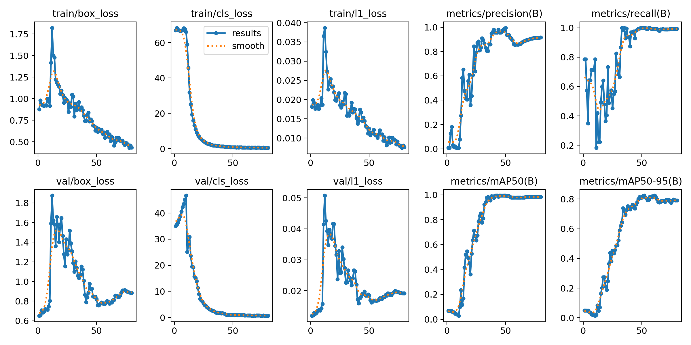
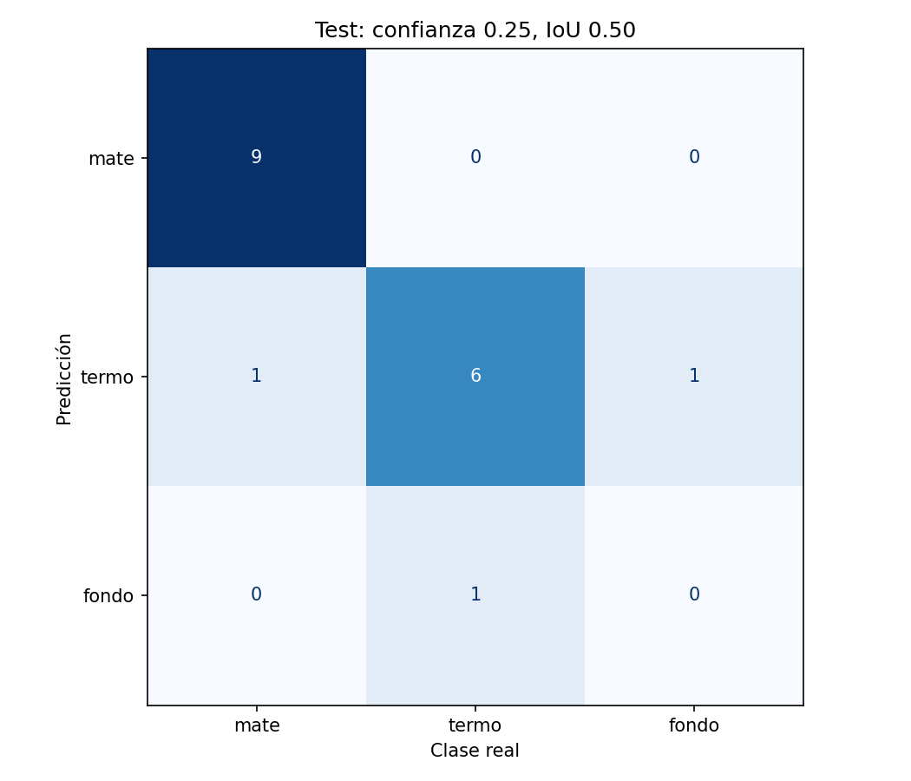
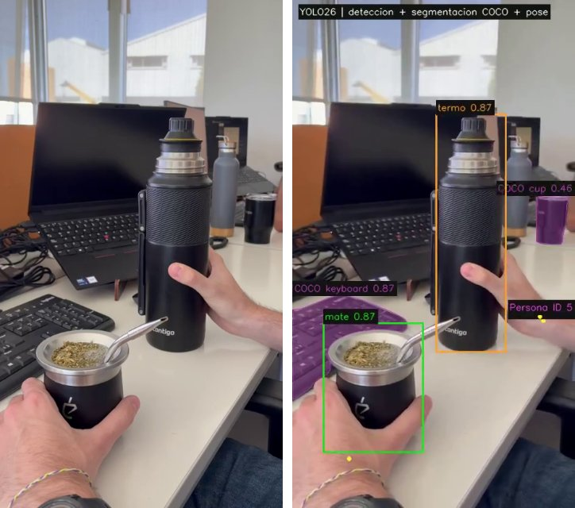
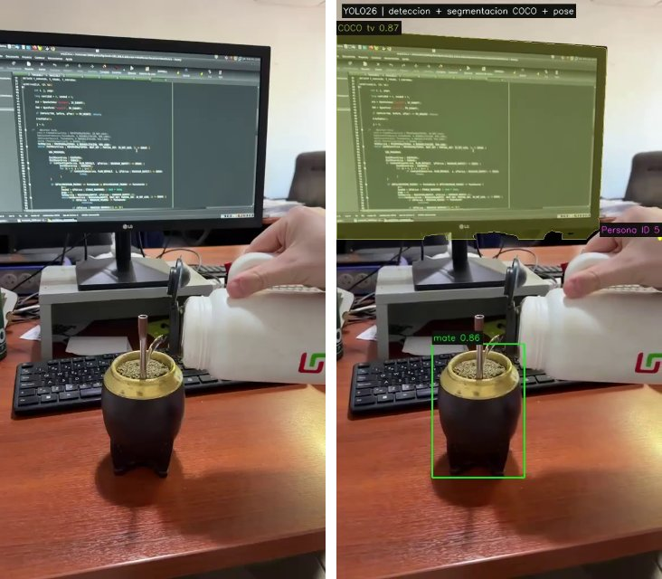
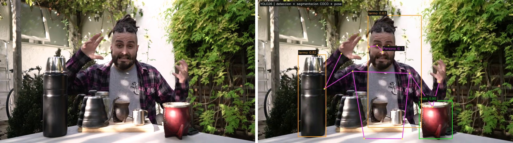
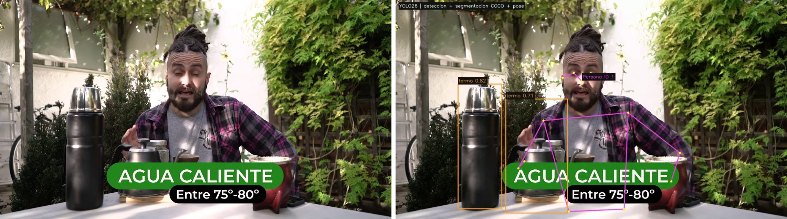
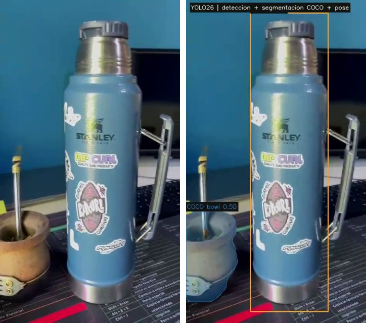

# Informe del trabajo final: detección, segmentación y pose con YOLO26

**Materia:** Visión por Computadora 2026, Licenciatura en Ciencia de Datos, Universidad del Gran Rosario (UGR).
**Grupo 5:** Bruno Pace, Franco Bianciotto, Franco Calcia, Tomas Avecilla y Juana Zorzolo.
**Fecha de entrega:** viernes 6 de noviembre de 2026.
**Repositorio:** <https://github.com/bpace1/CV-mate-detection>

Este informe cubre los puntos que pide el enunciado para la documentación: descripción del proyecto, dataset, proceso de entrenamiento, resultados, ejemplos del video procesado y conclusiones. Todos los números salen de los archivos del repositorio; al lado de cada tabla se indica de cuál.

## Índice

1. [Descripción del proyecto](#1-descripción-del-proyecto)
2. [Dataset utilizado](#2-dataset-utilizado)
3. [Proceso de entrenamiento](#3-proceso-de-entrenamiento)
4. [Resultados obtenidos](#4-resultados-obtenidos)
5. [Procesamiento de video](#5-procesamiento-de-video)
6. [Ejemplos del video procesado](#6-ejemplos-del-video-procesado)
7. [Conclusiones finales](#7-conclusiones-finales)
8. [Reproducibilidad](#8-reproducibilidad)
9. [Correspondencia con el enunciado](#9-correspondencia-con-el-enunciado)

## 1. Descripción del proyecto

Entrenamos un detector YOLO26 para dos clases que no están entre las 80 de COCO: **`mate`** (ID 0) y **`termo`** (ID 1). Después lo combinamos con dos modelos YOLO26 preentrenados en COCO para procesar videos. Cada fotograma pasa por tres modelos:

| Modelo | Pesos | Tarea | Qué se dibuja |
|---|---|---|---|
| YOLO26 Detection, entrenado por el grupo | `models/best.pt` | Detectar `mate` y `termo` | Caja, nombre de la clase y confianza |
| YOLO26 Segmentation | `yolo26n-seg.pt` (COCO) | Segmentar objetos COCO | Máscara y contorno, sin personas y sin lo que cae sobre un mate o un termo |
| YOLO26 Pose | `yolo26n-pose.pt` (COCO) | Estimar la pose de las personas | 17 keypoints, esqueleto e ID de seguimiento (ByteTrack) |

El trabajo está en dos notebooks:

- `notebooks/01_Entrenamiento_YOLO26.ipynb`: validación del dataset, partición, entrenamiento, evaluación y exportación de `best.pt`.
- `notebooks/02_Procesamiento_Videos_YOLO26.ipynb`: procesamiento de los videos con los tres modelos.

## 2. Dataset utilizado

### 2.1. Recolección

Son 90 fotos propias, sacadas por los integrantes del grupo, en `dataset/`. Hay distintos mates y termos, varios ambientes (comedor, mesada, cocina, cortina, entre otros), distintas distancias e iluminación, oclusión parcial por manos y 22 fotos con los dos objetos juntos. No hay imágenes negativas, sin mate ni termo.

### 2.2. Etiquetado

Anotamos con [MakeSense.ai](https://www.makesense.ai/). Cada integrante anotó un grupo de fotos y exportó un CSV. Los cuatro CSV están en `data/raw_annotations/`. `src/unify_annotations.py` los junta y escribe una etiqueta en formato YOLO por imagen en `data/unified/labels/`: `clase x_centro y_centro ancho alto`, normalizados entre 0 y 1. El ID se asigna según el nombre de la etiqueta, así que el orden de clases de cada export no importa.

Criterio de anotación: la caja cubre el recipiente visible y su base, sin estirarse para abarcar toda la bombilla. Si una mano tapa parte del objeto, la caja llega hasta donde se ve.

| ID | Clase | Imágenes con la clase | Cajas |
|---:|---|---:|---:|
| 0 | `mate` | 62 | 65 |
| 1 | `termo` | 50 | 51 |
| | **Total** | **90 imágenes** | **116** |

El dataset tiene **90 imágenes**. Las dos clases superan el mínimo de 50 del enunciado, que cuenta imágenes que contienen la clase, no cajas. Las columnas de clase suman 112 (62 + 50) porque 22 imágenes tienen los dos objetos y cuentan en las dos filas (62 + 50 − 90 = 22). Las cajas son 116 porque algunas fotos tienen más de una.

### 2.3. Revisión y validación

Antes del entrenamiento final revisamos a ojo las 90 fotos con sus cajas y corregimos cinco errores:

- `IMG_4037.jpeg`: estaba etiquetado como termo y es un mate.
- `termo-42.jpeg`: faltaba la caja del mate.
- `IMG_7160.jpg` e `IMG_7165.jpg`: faltaba un segundo mate, desenfocado al fondo.
- `01c37ef5-ac2f-4867-8b92-8fc876377a82.jpg`: faltaba un termo gris al fondo, cortado por el borde superior.

La sección 4 del notebook 01 (y `src/validate_dataset.py`) corta la ejecución si encuentra:
- imágenes ilegibles o duplicadas (compara el hash de los píxeles);
- etiquetas con formato inválido, clases desconocidas o cajas fuera de la imagen;
- un `classes.txt` en otro orden.

La sección 5 muestra ocho imágenes al azar con sus cajas para revisarlas.

### 2.4. Partición por sesiones

Muchas fotos se sacaron en la misma sesión, con el mismo lugar, la misma luz y los mismos objetos. Si dos fotos de una sesión quedan una en train y otra en test, el test mide cuánto se parecen y no si el modelo generaliza. Por eso agrupamos las fotos en **40 sesiones** (`data/source_groups.csv`), identificadas mirando las fotos y no con metadatos, y cada sesión va entera a un solo conjunto. El objetivo era 70/15/15 en imágenes, con un balance de clases parecido en los tres conjuntos.

| Conjunto | Imágenes | Sesiones | Imágenes con mate | Imágenes con termo |
|---|---:|---:|---:|---:|
| Train | 63 | 25 | 43 | 36 |
| Val | 13 | 7 | 9 | 7 |
| Test | 14 | 8 | 10 | 7 |

Fuente: salida de la sección 6 del notebook 01.

El split está fijado en `data/split_manifest.csv`, con el SHA-256 de cada imagen y etiqueta. El notebook lo reutiliza y se detiene si algún archivo cambió, así que el split no se rehízo para mejorar el resultado en test.

### 2.5. Formato YOLO y `data.yaml`

`python src/prepare_dataset.py` (o la sección 6 del notebook 01) copia imágenes y etiquetas a la estructura que espera Ultralytics:

```text
dataset_yolo26_mate_termo/
├── images/{train,val,test}/
└── labels/{train,val,test}/
```

`data.yaml`, en la raíz del repositorio, apunta a esa carpeta con rutas relativas:

```yaml
train: dataset_yolo26_mate_termo/images/train
val: dataset_yolo26_mate_termo/images/val
test: dataset_yolo26_mate_termo/images/test
names:
  0: mate
  1: termo
```

La carpeta dividida no está versionada porque se genera a partir de `dataset/`, `data/unified/labels/` y el manifiesto. En la carpeta de entrega va armada (ver la sección 9).

## 3. Proceso de entrenamiento

### 3.1. Arquitectura utilizada

Usamos **YOLO26n** (nano), la variante más chica de la familia YOLO26 de Ultralytics. Es un detector de una etapa con backbone convolucional, cuello de fusión multiescala y cabeza de detección sin anclas. Hicimos **transfer learning**: partimos de `yolo26n.pt`, entrenado en COCO con 80 clases, y Ultralytics reemplazó la cabeza para 2 clases (`Overriding model.yaml nc=80 with nc=2`). Se transfirieron 696 de los 708 tensores de pesos (`Transferred 696/708 items`). Los 12 que faltan son el peso y el sesgo de la última convolución de la rama de clasificación (`model.23.cv3.*.2` y `model.23.one2one_cv3.*.2`), en las tres escalas y en las dos cabezas de YOLO26: uno-a-muchos y uno-a-uno, sin NMS. Esa capa cambia de 80 a 2 salidas y se inicializa de cero. Se entrenó la red completa, sin congelar capas.

| Característica | YOLO26n (modelo final) | YOLO26s (candidato comparado) |
|---|---:|---:|
| Capas | 260 | 260 |
| Parámetros | 2.504.580 | 9.949.412 |
| GFLOPs (640 px) | 5,9 | 22,7 |
| Capas / parámetros fusionados (inferencia) | 121 / 2.389.978 | 120 / 9.465.954 |
| Clases de salida | 2 | 2 |

Fuente: resumen que imprime Ultralytics en el log de la sección 7 del notebook 01.

### 3.2. Hiperparámetros

| Parámetro | Valor | Comentario |
|---|---|---|
| Pesos iniciales | `yolo26n.pt` (COCO) | Transfer learning |
| Épocas | 80 como máximo | El modelo final completó las 80 |
| Early stopping | `patience=20` | No llegó a cortar: la mejor época fue la 61 |
| **Batch size** | **16** | Igual para todos los candidatos |
| **Tamaño de imagen** | **640 × 640 px** | Igual en entrenamiento, validación, test y video |
| Optimizador | AdamW, lr0 = 0,001667, momentum 0,9 | `optimizer='auto'`: Ultralytics lo elige según el tamaño del dataset |
| Decaimiento del lr | Lineal hasta lr0 × 0,01 (`lrf=0.01`), con 3 épocas de warmup | |
| Weight decay | 0,0005 | |
| Precisión mixta | AMP activado | |
| Semilla | 42, `deterministic=True` | |
| Mosaic | 0,0 en el modelo final | Ver la comparación de 3.3 |
| Otros aumentos | HSV (h 0,015, s 0,7, v 0,4), traslación 0,1, escala 0,5, volteo horizontal 0,5, random erasing 0,4 | Valores por defecto de Ultralytics 8.4.202 |
| Entorno | Google Colab, GPU Tesla T4, Python 3.13.16, PyTorch 2.11.0+cu130, Ultralytics 8.4.202 | |

Fuentes: `resultados/comparacion_mejoras/configuracion.json`, metadatos guardados en `models/best.pt` (`train_args`) y log del notebook 01.

Cada entrenamiento de YOLO26n tardó unos 5 minutos en la T4 (0,087 a 0,090 horas) y el de YOLO26s unos 6,4 minutos.

### 3.3. Selección del modelo

Entrenamos cuatro candidatos con el mismo split, la misma semilla y los mismos hiperparámetros. Solo cambian el modelo base y la probabilidad de mosaic, un aumento que pega cuatro imágenes en una. En los candidatos con mosaic, se apaga en las últimas 60 épocas (`close_mosaic=60`).

| Candidato | Modelo base | Mosaic | mAP50 (val) | mAP50-95 (val) |
|---|---|---:|---:|---:|
| **`n_sin_mosaic`** | `yolo26n.pt` | 0,0 | 0,978 | **0,824** |
| `n_mosaic100` | `yolo26n.pt` | 1,0 | 0,981 | 0,814 |
| `n_mosaic50` | `yolo26n.pt` | 0,5 | 0,995 | 0,797 |
| `s_mosaic50` | `yolo26s.pt` | 0,5 | 0,944 | 0,704 |

Fuente: `resultados/comparacion_mejoras/comparacion_validacion.csv`. Gráfico: `resultados/comparacion_mejoras/comparacion_validacion.png`.

El protocolo fue:

1. Elegir el candidato con mayor mAP50-95 en **validación**: YOLO26n sin mosaic.
2. Elegir la confianza de trabajo con un barrido sobre **validación**: 0,25, la que maximiza el F1 macro (0,974; ver `umbrales_validacion.csv`).
3. Recién con el modelo y la confianza fijos, evaluar **una sola vez en test**.

Las diferencias entre los tres modelos `n` son de uno o dos puntos con una sola semilla. Eso no alcanza para afirmar que una configuración de mosaic sea mejor que otra. El modelo `s`, con cuatro veces más parámetros, quedó último: con 63 imágenes de entrenamiento, más capacidad no se tradujo en mejores resultados.

### 3.4. Curvas de entrenamiento



Fuente: `resultados/comparacion_mejoras/results.png` y `results.csv`.

- **Épocas 1 a 12.** Las pérdidas suben y el mAP de validación queda cerca de cero. Es la etapa en que la cabeza nueva, inicializada de cero, aprende las dos clases, mientras el learning rate sale del warmup. La pérdida de clasificación arranca en unos 67 porque esa cabeza todavía no sabe nada.
- **Épocas 12 a 40.** Las pérdidas de train y val bajan, y el mAP50 de validación pasa de 0,1 a 0,98.
- **Épocas 40 a 80.** El mAP50 se estabiliza en 0,98 y el mAP50-95 llega a su máximo, 0,824, en la época 61. Desde la época 52 la pérdida de cajas en validación sube de 0,76 a 0,88 mientras la de train sigue bajando: es un sobreajuste leve. Por eso el mAP50-95 de validación termina en 0,792 en la época 80. `best.pt` guarda los pesos de la época 61, no los de la última.

## 4. Resultados obtenidos

### 4.1. Métricas en test

Son 14 imágenes y 17 objetos que el modelo no vio ni durante el entrenamiento ni durante la selección.

- **mAP50 y mAP50-95** se calculan como Ultralytics, con `conf=0.001`, recorriendo toda la curva precisión-recall.
- **Precisión, recall y F1** se calculan con la confianza 0,25 elegida en validación. Cada objeto real se empareja con a lo sumo una predicción con IoU de 0,5 o más. Los valores globales son el promedio de las dos clases (macro).

| Métrica | Global | `mate` | `termo` |
|---|---:|---:|---:|
| Precisión | 0,875 | 1,000 | 0,750 |
| Recall | 0,879 | 0,900 | 0,857 |
| F1 | 0,874 | 0,947 | 0,800 |
| mAP50 | 0,905 | 0,957 | 0,852 |
| mAP50-95 | 0,593 | 0,628 | 0,558 |

Fuentes: `resultados/comparacion_mejoras/metricas_test.json` y `metricas_por_clase.csv`.

### 4.2. Matriz de confusión



Filas: predicción. Columnas: clase real. "Fondo" significa sin objeto.

- 9 de 10 mates y 6 de 7 termos se detectan con la clase correcta.
- 1 mate se clasifica como termo.
- 1 termo no se detecta.
- 1 detección de termo no corresponde a ningún objeto (falso positivo).

Los tres errores involucran a la clase `termo`. Por eso su precisión (0,75) y su F1 (0,80) son los más bajos. El detalle de cada error está en `resultados/comparacion_mejoras/errores_test.json`.

Curvas precisión-recall y F1-confianza en test: `resultados/comparacion_mejoras/BoxPR_curve.png` y `BoxF1_curve.png`.

### 4.3. Interpretación

- **El modelo encuentra los objetos, pero las cajas no siempre ajustan bien.** El mAP50 (0,905) queda muy por encima del mAP50-95 (0,593). Con IoU 0,5 casi todo cuenta como acierto; con IoU exigentes, de 0,75 a 0,95, no. Influye el criterio de anotación: dónde termina la bombilla y cuánto tapa la mano son decisiones ambiguas.
- **Validación y test no coinciden.** La validación dio mAP50-95 0,824 y el test 0,593. Parte de la diferencia es que el modelo y la confianza se eligieron con validación, lo que la vuelve optimista. La otra parte es el tamaño: con 13 y 14 imágenes, una sola sesión difícil mueve mucho el resultado.
- **Las métricas tienen mucha incertidumbre.** Con 17 objetos en test, un error mueve el recall de `mate` 10 puntos y el de `termo` 14.
- **Primera corrida.** `resultados/historico_original/` guarda la primera corrida: etiquetas sin corregir, otro split, mosaic por defecto y 120 épocas como máximo. Dio mAP50 0,708 en un test de 9 imágenes. No se puede comparar con la corrida final porque cambiaron las etiquetas y el split, y ese modelo había visto en entrenamiento fotos que ahora son test. Sus pesos están en `resultados/historico_original/old_best.pt` **solo como referencia: no son los pesos entregados**.

## 5. Procesamiento de video

### 5.1. Videos de entrada

| Video | Duración | FPS | Resolución | Fotogramas | Origen |
|---|---:|---:|---|---:|---|
| `video01.mp4` | 9,3 s | 30 | 576×1024 | 278 | Grabado por el grupo |
| `video02.mp4` | 21,7 s | 60 | 464×832 | 1301 | Grabado por el grupo |
| `video03.mp4` | 10,6 s | 60 | 464×832 | 633 | Grabado por el grupo |
| `video04.mp4` | 25,0 s | 25 | 1280×720 | 625 | YouTube |

Los videos 01 a 03 son planos cerrados de una mesa de trabajo con mate, termo, laptop y teclado; de las personas se ven solo manos y brazos. Para evaluar la pose hacía falta una persona más visible, y por eso sumamos `video04.mp4`. Son los primeros 25 segundos de [La forma definitiva de preparar mate](https://www.youtube.com/watch?v=I5JOt0B6iS8), del canal Sudamerican Mate. YouTube no informa una licencia Creative Commons para ese video, así que lo usamos solo como ejemplo académico. La fuente, el recorte y el hash están en `videos/input/video04_fuente.json`. Todos los videos duran menos de los 2 minutos que permite el enunciado.

### 5.2. Configuración

| Componente | Modelo | Umbral |
|---|---|---|
| Detección de `mate` y `termo` | `models/best.pt` | Confianza 0,25 (elegida en validación) |
| Segmentación COCO | `yolo26n-seg.pt` | Confianza 0,45, definida por el grupo |
| Pose | `yolo26n-pose.pt` + ByteTrack | Confianza 0,35 por persona y 0,35 por keypoint |
| Tamaño de inferencia | | 640 px en los tres modelos |

Fuente: `videos/output/configuracion_procesamiento.json`.

Reglas del enunciado y cómo se cumplen:

- **La segmentación no incluye personas.** Las máscaras de la clase `person` se descartan por nombre.
- **La segmentación no incluye las clases nuevas.** COCO no tiene `mate` ni `termo`, pero el segmentador los pinta como `cup`, `bowl` o `bottle`. Por eso se descarta toda máscara que tenga la mitad o más de su área, o de la caja, dentro de una caja de mate o termo detectada en los últimos 2 segundos. Sin esa memoria temporal, las máscaras eran 389, 1184, 1578 y 272 por video; con ella, 378, 490, 1157 y 13, y casi desaparecieron las tazas pintadas sobre mates.
- **Seguimiento de la pose.** El modelo de pose corre con `track(..., persist=True)` y ByteTrack, así que cada persona mantiene un ID entre fotogramas. Se crea un tracker nuevo por video.
- **Orden de dibujo.** Primero las máscaras, encima la pose y arriba de todo las cajas propias, para que las cajas siempre se vean. La salida conserva la resolución y los FPS del original y se convierte a H.264.
- **Verificación de pesos.** Antes de procesar, el notebook 02 comprueba que el SHA-256 de `models/best.pt` coincida con `models/inferencia.json`, para no usar una confianza calibrada para otros pesos.

### 5.3. Resultados por video

| Video | Fotogramas | Detecciones de mate | Detecciones de termo | Máscaras COCO | Poses | Tiempo (s) |
|---|---:|---:|---:|---:|---:|---:|
| video01 | 278 | 282 | 98 | 378 | 113 | 36,1 |
| video02 | 1301 | 702 | 913 | 490 | 427 | 153,8 |
| video03 | 633 | 751 | 398 | 1157 | 1779 | 87,4 |
| video04 | 625 | 261 | 868 | 13 | 628 | 75,5 |

Fuente: `videos/output/resumen_procesamiento.csv`.

Los conteos suman apariciones en cada fotograma, no objetos distintos: un mate visible durante 100 cuadros cuenta 100 veces. No miden precisión, porque los videos no tienen etiquetas. La corrida guardada se hizo en CPU: 2837 fotogramas en 353 s, unos 8 fotogramas por segundo contando lectura, tres inferencias, dibujo y conversión. En una T4 de Colab la misma corrida tardó 249 s. En los dos casos es procesamiento offline, más lento que los FPS de los videos.

## 6. Ejemplos del video procesado

En cada imagen, a la izquierda está el fotograma original y a la derecha el procesado. Los videos completos están en `videos/output/`.

**Las tres capas juntas** (`video03`, segundo 5). Caja de `mate` 0,87 y de `termo` 0,87; máscaras COCO de `keyboard` y `cup`; pose de la mano con su ID. El termo no recibe máscara de `bottle` y el mate no recibe máscara de `cup`.



**Detección y segmentación** (`video01`, segundo 4). `mate` 0,86 y máscara de `tv` 0,87 sobre el monitor. El modelo de pose toma la mano como una persona (ID 5), aunque se ve muy poco del cuerpo.



**Pose de cuerpo entero con seguimiento** (`video04`, segundo 8). Esqueleto e ID 1 sobre la persona; `termo` 0,82 y `mate` 0,90 correctos. También aparece un error típico: una caja de `termo` 0,63 sobre la cabeza y el torso.



**Confusión con una pava** (`video04`, segundo 15). El termo real se detecta con 0,82, pero la pava de metal oscuro también se marca como `termo` (0,71). El mate rojo queda tapado por el texto sobreimpreso y no se detecta.



**Límite de la regla de máscaras** (`video02`, segundo 10,85). El detector pierde el mate durante más de 2 segundos y el segmentador lo pinta como `bowl` 0,50. El termo sí se detecta, pero su caja llega al borde superior y la etiqueta queda tapada por el título del video.



Las imágenes se extrajeron de los videos de `videos/input/` y `videos/output/` y están en `docs/img/`. El notebook 02, sección 6, muestra además un fotograma de cada video.

## 7. Conclusiones finales

**Se cumplió el objetivo.** Entrenamos con transfer learning un detector YOLO26n para dos clases ajenas a COCO, con un dataset propio de 90 fotos (62 con mate y 50 con termo) etiquetadas en formato YOLO. Lo integramos con YOLO26 Segmentation y YOLO26 Pose en un mismo pipeline de video: cada fotograma muestra a la vez las cajas de `mate` y `termo` con nombre y confianza, las máscaras de los objetos COCO (sin personas ni clases propias) y el esqueleto de las personas con seguimiento.

**El detector funciona bien en condiciones parecidas al entrenamiento.** En test logra mAP50 0,905 y F1 macro 0,874. `mate` es la clase más confiable (F1 0,947) y `termo` concentra todos los errores (F1 0,800). La localización fina es el punto más débil (mAP50-95 0,593).

**Los videos muestran errores que el test no muestra.** En `video04`, una escena exterior con otra persona y otros objetos, aparecen termos falsos sobre la cabeza, el torso y una pava, y el mate rojo se pierde en varios cuadros. Esa escena no se parece a las fotos de entrenamiento, y por eso mide mejor la generalización que un test de 14 imágenes de las mismas casas. El modelo aprendió "objeto cilíndrico, alto y oscuro" más que "termo".

**La integración exige reglas propias.** Los modelos COCO no conocen las clases nuevas, así que el segmentador pinta los mates como `cup` y los termos como `bottle`. Lo resolvimos con una regla de superposición con memoria de 2 segundos, pero depende del detector: si pierde el objeto más tiempo, la máscara vuelve. Además, la regla puede ocultar un objeto COCO real que quede en el lugar de una caja reciente.

**La pose depende del encuadre.** En `video04` el esqueleto sigue los brazos y el ID se mantiene. En los planos cerrados de los videos 01 a 03, el modelo toma una mano o un brazo como persona con uno o dos keypoints; por eso `video03` suma 1779 poses que no aportan.

**Limitaciones.**
- El dataset es chico: 90 fotos, 40 sesiones y pocos ambientes.
- Hay un solo split y una sola semilla por candidato, así que las diferencias entre configuraciones de mosaic no son concluyentes.
- No hay etiquetas en los videos para medir la precisión del pipeline.
- El procesamiento no llega a tiempo real en CPU ni en una T4, porque corre tres modelos por fotograma.

**Qué haríamos después.**
1. Sumar fotos de escenas nuevas, de personas usando el mate y el termo, y negativos difíciles (tazas, pavas, botellas, caras) para bajar los falsos termos.
2. Repetir la comparación con varias semillas o con validación cruzada por sesiones.
3. Etiquetar algunos fotogramas de los videos para medir el pipeline completo.
4. Filtrar las poses con pocos keypoints confiables.
5. Grabar videos con el cuerpo de la persona más visible.

## 8. Reproducibilidad

El README explica cómo correr los notebooks en Colab y en local. En resumen:

1. **Etiquetas y split:** `python src/unify_annotations.py`, `python src/validate_dataset.py` y `python src/prepare_dataset.py`.
2. **Entrenamiento:** notebook 01 en Colab con GPU T4. Escribe `models/best.pt` y `models/inferencia.json`.
3. **Videos:** notebook 02. Usa los pesos de `models/` y escribe en `videos/output/`.

Qué controles hay:
- Las versiones están fijadas en los archivos `requirements*.txt` (Ultralytics 8.4.202).
- La semilla es 42 y el entrenamiento corre en modo determinista.
- El split se valida con hashes.
- El notebook 02 verifica el hash de los pesos.
- `videos/output/configuracion_procesamiento.json` registra los hashes de los pesos y de cada video de entrada.

Igual puede haber diferencias numéricas chicas entre GPUs. Además, el notebook 01 usa batch 16 en Colab y batch 4 fuera de Colab, para GPUs con menos memoria. Los resultados de este informe corresponden a la corrida en Colab con batch 16, cuyos pesos tienen SHA-256 `37910d2adef0de5b7beb35a9a716d23c72aa9af885e8c86aa5da47a73a959ef6`.
